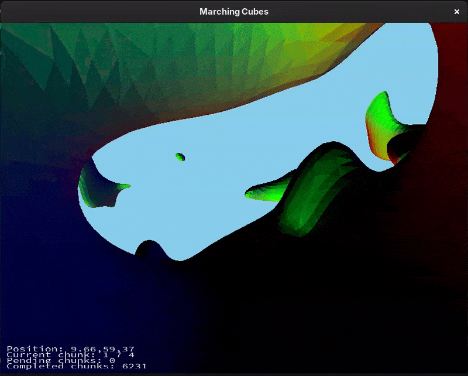

# MarchingCubes

[英語版（English）](./README.md)

## 概要
本プロジェクトでは、C++11とOpenGLを使用してマーチングキューブ（Marching Cubes）アルゴリズムを実装してみました。（滑らかで連続的な3D地形をリアルタイムにプロシージャル生成するため）



## 機能
1. マーチングキューブによるメッシュ生成
   - 任意のスカラー密度場から滑らかな3Dポリゴンメッシュを抽出。
   - Eric Lengyel氏の[Transvoxel Algorithm](https://transvoxel.org/)に基づく改良ルックアップテーブル（通常セル向け16種類のエキバレンスクラス）を採用。
   - キューブの辺上で頂点位置を線形補間し、ボクセル特有の角ばりを抑えた滑らかな地形傾斜を生成。
2. マルチスレッドによるチャンク生成
   - 4つのバックグラウンドワーカースレッドによるスレッドプールで、描画をブロックすることなく非同期にボクセルを三角面化。
   - スレッドセーフなジョブキューにより、チャンク生成タスクを適切に管理・割り当て。
3. プロシージャル3D地形
   - シンプレックスノイズの複数オクターブを重ね合わせ、オーバーハングや洞窟、起伏に富んだ地形を生成。
   - 高さに基づく密度グラデーションに、周波数と振幅が異なる9層のノイズパスを合成。
   - 球体や直方体などの幾何プリミティブをテスト可能な符号付き距離関数（SDF）も収録。
4. 動的チャンクストリーミング
   - ワールド空間を3Dチャンク（8x8x8）単位に分割管理。
   - 設定可能な描画距離（デフォルト: 8x8x8）に基づき、プレイヤー周辺のチャンクを動的に読み込み。
   - 範囲外となった遠方のチャンクを自動的に解放し、メモリ使用量を抑制。
5. テッセレーション水面プレーン
   - OpenGLのハードウェアテッセレーション（テッセレーション制御＆評価シェーダー）を活用した連続的な水面描画。
   - アルファブレンディングとPhong鏡面反射ハイライトを実装。
6. カメラ & デバッグUI
   - キーボード（WASD）とマウス視点移動による自由な一人称視点カメラ。
   - FreeTypeを用いた画面テキスト表示により、カメラ座標、現在チャンク座標、処理待ち・完了チャンク数をリアルタイム表示。

## 操作方法
| 入力 | アクション |
| :--- | :--- |
| **W / S** | 前進 / 後退 |
| **A / D** | 左右平行移動（ストラフ） |
| **マウス移動** | 視点移動（ヨー / ピッチ） |
| **Escape** | アプリケーション終了 |

## 技術スタックと依存関係
- **言語**: C++11
- **グラフィックスAPI**: OpenGL 4.1
- **ウィンドウ / 入力**: GLFW 3
- **OpenGLローダー**: [GLAD](https://glad.dav1d.de/)
- **数学ライブラリ**: [GLM](https://github.com/g-truc/glm) (OpenGL Mathematics)
- **ノイズ生成**: [FastNoiseLite](https://github.com/Auburn/FastNoiseLite)
- **フォント描画**: [FreeType](https://freetype.org/)
- **ビルドシステム**: CMake (3.10+)

## プロジェクト構成

```text
|-- include/
|   |-- Engine/
|   |   |-- Font/                 # FreeTypeフォントラッパー
|   |   |-- Geometry/
|   |   |   |-- BoundingVolumes/  # 軸平行境界ボックス（AABB）
|   |   |-- Graphics/             # カメラ、レンダラー、シェーダープログラム、メッシュ
|   |   |-- UI/                   # 画面テキスト描画
|   |   |-- Application.hpp       # エンジンのコアアプリケーションループ
|   |   |-- Input.hpp             # GLFWキーボードおよびマウス入力管理
|   |   |-- ResourceManager.hpp   # シェーダーのキャッシュと寿命管理
|   |   |-- SceneBase.hpp         # シーン抽象インターフェース
|   |   |-- Time.hpp              # デルタタイム・フレーム時間管理
|   |-- Chunk.hpp                 # チャンクのデータ構造と境界
|   |-- Cube.hpp                  # 直方体の符号付き距離関数（SDF）
|   |-- Edge.hpp                  # 2D線分定義
|   |-- MainScene.hpp             # メインの3Dマーチングキューブ地形シーン
|   |-- MarchingCubes.hpp         # Transvoxelルックアップテーブルと等値面抽出
|   |-- MarchingCubes2DScene.hpp  # 2Dマーチングスクエア（等値線）検証シーン
|   |-- Sphere.hpp                # 球体の符号付き距離関数（SDF）
|   |-- Terrain.hpp               # 3Dマルチオクターブノイズ密度場
|   |-- Triangle.hpp              # 3D三角形および法線計算
|-- src/
|   |-- Engine/                   # カスタムエンジンの実装
|   |-- Main.cpp                  # エントリーポイント
|   |-- MainScene.cpp             # チャンクストリーミング、スレッドプール、描画処理
|   |-- MarchingCubes.cpp         # ボクセル辺の補間と三角面化
|   |-- MarchingCubes2DScene.cpp  # 2Dスカラー輪郭線抽出の実装
|   |-- SandboxScene.cpp          # UIサンドボックス検証シーン
|-- resources/
|   |-- fonts/                    # TrueTypeフォントファイル（SourceCodePro）
|   |-- shaders/                  # GLSLシェーダー（地形、水面テッセレーション、カラー、フォント）
|-- deps/                         # 外部依存ライブラリ（GLAD, GLM, FastNoiseLite）
|-- CMakeLists.txt                # CMakeビルド設定
|-- compile.sh                    # ビルドスクリプト
```

## ビルドと実行

### 前提条件
- CMake 3.10 以上
- C++11 対応コンパイラ（GCC、Clang、または MSVC）
- システムにインストールされた OpenGL、GLFW 3、および FreeType ライブラリ

### ビルド手順

#### Linux / macOS / WSL の場合:
```bash
./compile.sh
cd build
./MarchingCubes
```

#### Windows (CMake & Visual Studio / Ninja) の場合:
```bash
cmake -B build -S .
cmake --build build --config Release
cd build/Release
./MarchingCubes.exe
```
